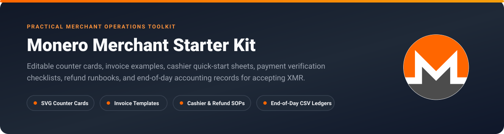
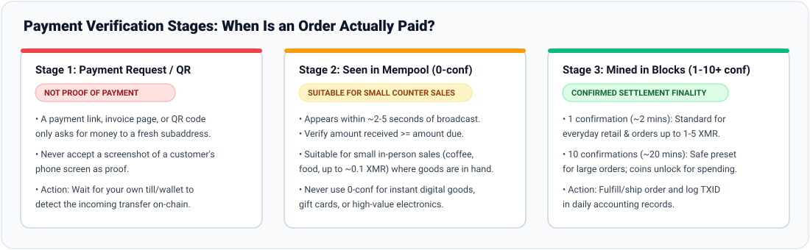

  

# Monero Merchant Starter Kit  

> A practical, open-source operational kit for freelancers, market sellers, cafes, small shops, and creators accepting **Monero (XMR)** in person or by invoice.

Accepting Monero requires no merchant account, carries zero processor fees, and eliminates chargeback fraud. However, real-world operations require clear answers to practical questions: *What goes on the counter? When is an order actually paid? What if a customer sends too little or too much? How do refunds work when sender addresses are private?*

This repository provides **editable vector assets, staff checklists, invoice examples, refund workflows, and end-of-day accounting records** tied to tested non-custodial workflows.

---

## What Is Included in This Kit

| Deliverable | Files | Purpose |
|---|---|---|
| **Editable Counter Cards** | [`counter-cards/monero-counter-card-portrait.svg`](counter-cards/monero-counter-card-portrait.svg) [`counter-cards/monero-counter-card-landscape.svg`](counter-cards/monero-counter-card-landscape.svg) [`counter-cards/README.md`](counter-cards/README.md) | Print-ready 5"×7" portrait and 6"×4" landscape vector counter signs with official Monero symbol and custom QR slot. |
| **Invoice & Receipt Examples** | [`invoices/monero-invoice-example.svg`](invoices/monero-invoice-example.svg) [`invoices/monero-invoice-template.md`](invoices/monero-invoice-template.md) [`invoices/README.md`](invoices/README.md) | Editable B2B/freelance payment request and post-settlement receipt templates with price-lock and subaddress fields. |
| **Cashier Quick-Start & Verification Checklist** | [`cashier-guide/cashier-cheat-sheet.md`](cashier-guide/cashier-cheat-sheet.md) [`cashier-guide/payment-verification-checklist.md`](cashier-guide/payment-verification-checklist.md) | 1-page register reference and shift checklist covering `0-conf` vs. confirmed finality, partial payments, and dropped tx handling. |
| **Refund & Dispute Runbook** | [`refunds-runbook/README.md`](refunds-runbook/README.md) | Step-by-step workflow for verifying purchase proof (`tx_key`), collecting a customer refund address, and returning overpayments. |
| **End-of-Day Records & Accounting** | [`accounting-templates/monero-daily-sales-ledger.csv`](accounting-templates/monero-daily-sales-ledger.csv) [`accounting-templates/end-of-day-reconciliation.csv`](accounting-templates/end-of-day-reconciliation.csv) [`accounting-templates/README.md`](accounting-templates/README.md) | Sample transaction ledger and shift closeout templates for reconciling multi-till subaddress indices and fiat totals. |

---

## Visual Asset Previews

### 1. Printable Counter Display Cards (`.svg`)

  
  &nbsp;&nbsp;
  

### 2. Payment Verification Stages

  

### 3. Commercial Invoice Example (`.svg` & Markdown)

  

---

## Two Operational Workflows (Wallet-Neutral & Browser Till)

### Workflow A: Standard Wallet-Neutral Path (Monero GUI, Feather, Cake Wallet)
Best for freelancers, occasional sellers, and single-counter setups using a desktop or mobile wallet:
1. **Create a Watch-Only Counter Wallet (Optional but Recommended):** Keep your seed and spend key offline; import only the primary address and private view key onto the shop device so staff can see incoming payments without spending authority.
2. **Generate a Fresh Subaddress per Sale:** Create a new subaddress (`8...`) for each invoice or order so two sales for the same amount are never confused.
3. **Present the Request:** Format a standard [`monero:` URI](https://github.com/monero-project/monero/blob/master/docs/URI_SCHEME.md) QR code with `tx_amount` and `recipient_name`.
4. **Verify & Record:** Wait for the transaction to reach your selected confirmation threshold, then log the sale in [`monero-daily-sales-ledger.csv`](accounting-templates/monero-daily-sales-ledger.csv) or export your wallet history to CSV.

### Workflow B: Browser Till & Payment Links Path (MonkStash)
Best for cafes, market stalls, multi-register counters, and remote invoices without running a server:
1. **In-Person Counter Till ([MonkStash POS Guide](https://monkstash.com/monero-pos)):**
   - Open [wallet.monkstash.com](https://wallet.monkstash.com) in watch-only or full mode and enable **Cashier / Till mode**.
   - Select your currency (25+ fiat currencies or XMR), confirmation speed (`quick`, `standard`, or `safe`), and till number (`1` to `8` - each till uses a separate Monero wallet account so multiple registers never hand out the same subaddress).
   - Type the sale price; the screen displays a fresh subaddress QR code with a locked XMR quote and automatically marks the sale **Paid** when the required confirmations arrive.
2. **Remote Invoices ([MonkStash Payment Links Guide](https://monkstash.com/monero-payment-link)):**
   - Create a payment request in your browser wallet and share the generated `/pay#...` link. Invoice details stay in the URL fragment (`#`), which browsers never transmit to a server.
3. **End-of-Day Export:**
   - Download `monkstash-sales-YYYY-MM-DD.csv` or `monkstash-payment-requests-YYYY-MM-DD.csv` directly in the browser for bookkeeping.

---

## Operational Boundaries & Important Limits

1. **A Payment Request or QR Code Is Never Proof of Payment:**
   Anyone can generate or screenshot a payment link, invoice, or QR code. Only treat an order as paid when your own wallet, till, or payment server observes the incoming transaction on the Monero network.
2. **Choose Confirmation Policies by Delivery Risk:**
   - **`quick` (`0-conf` up to 0.1 XMR, `1-conf` up to 1 XMR, `10-conf` above):** Suitable only when you can stop handing over physical goods (such as a coffee at a counter) if an unconfirmed transaction disappears from the mempool.
   - **`standard` (`1-conf` up to 5 XMR, `10-conf` above):** Recommended baseline for everyday retail and shipped orders.
   - **`safe` (`10-conf`, ~20 minutes):** Required for high-value items and any instant digital delivery (gift cards, downloads, license keys).
3. **Refunds Cannot Be Sent "Back to Sender Automatically":**
   Monero transactions use one-time stealth addresses and do not reveal the sender's wallet address. Always follow the [Refund Runbook](refunds-runbook/README.md) to verify purchase proof and collect a customer refund address.
4. **Local Tax & Receipt Compliance:**
   Invoice and receipt regulations vary across jurisdictions. Adapt the provided templates to include any mandatory tax identifiers, sequential invoice numbers, or VAT/GST breakdowns required by local law.

---

## Related Projects

- **[Awesome Monero Payments](https://github.com/90ssolo/awesome-monero-payments):** Structured technical comparison of Monero payment servers, browser tills, CMS plugins, and Rust/Node libraries.
- **[MonkStash for Business](https://monkstash.com/business):** Live browser till, payment links, free Monero QR/address tools, and self-hosted checkout documentation.

---

## License

Released under the [MIT License](LICENSE). Free to edit, print, rebrand, and use commercially.
