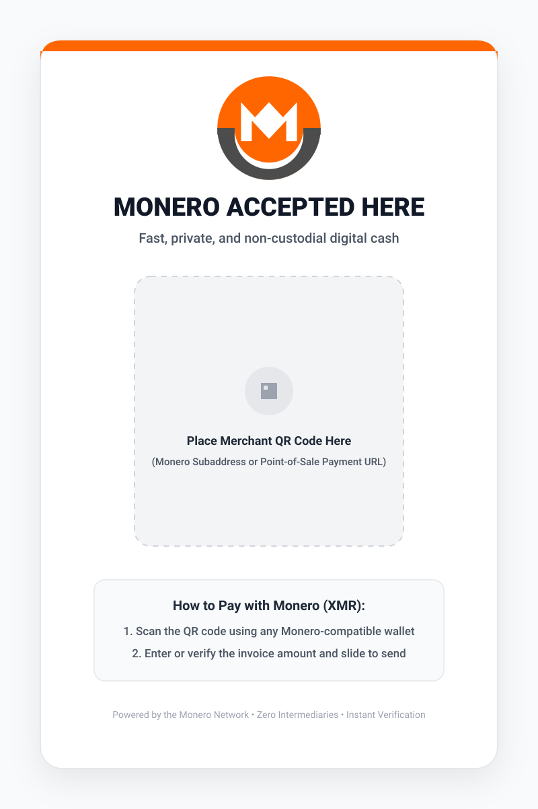
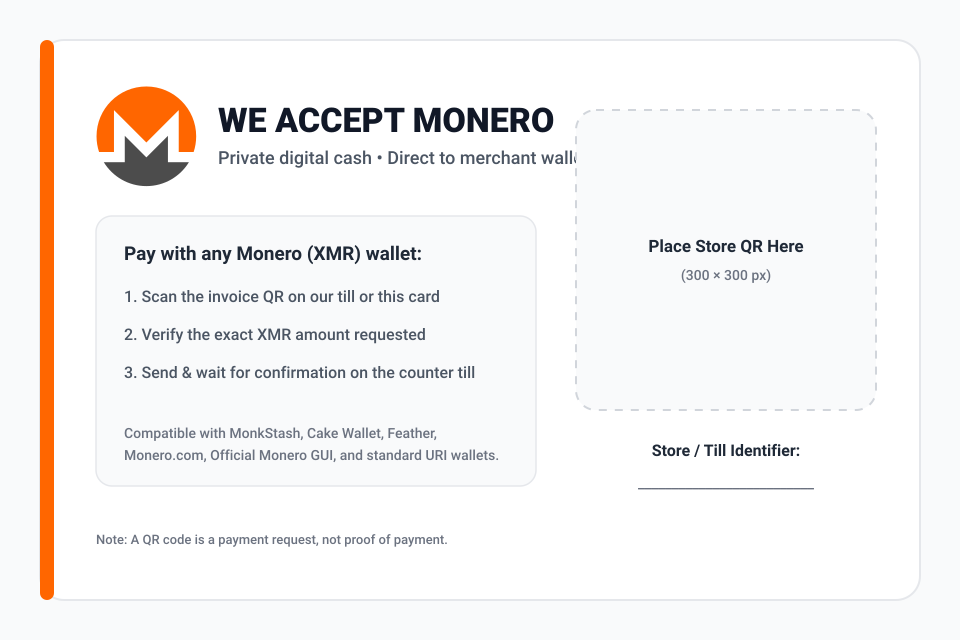

# Counter Display Cards: Customization & Printing Guide

This directory contains editable, vector-based printable counter cards (`.svg`) for physical storefronts, retail counters, cafes, event kiosks, and market stalls.

---

## Files in This Directory

| File | Dimensions / Aspect Ratio | Best Use Case |
|---|---|---|
| [`monero-counter-card-portrait.svg`](monero-counter-card-portrait.svg) | **5" × 7" Portrait** (`800 × 1120`) | Standard acrylic T-stand on a café or shop counter |
| [`monero-counter-card-landscape.svg`](monero-counter-card-landscape.svg) | **6" × 4" Landscape** (`960 × 640`) | Cash register display, tent card, or storefront window sign |

### Live Vector Previews

<p align="center">
  
  &nbsp;&nbsp;
  
</p>

---

## How to Customize for Your Business

You can customize these `.svg` templates in **2 minutes** using Inkscape (free/open-source), Figma, Affinity Designer, Adobe Illustrator, or any text editor.

### Option A: Dynamic Till at the Counter (Recommended for Retail)
If you use a phone or tablet as a live counter till (such as [MonkStash POS](https://monkstash.com/monero-pos) or Feather/Cake Wallet):
1. Each order gets its own fresh subaddress and exact XMR amount on the tablet screen.
2. You can place a QR code on the printed counter card pointing to your shop's payment information page, or use the card as an awareness sign next to your register tablet.

### Option B: Static Subaddress QR (Tips, Fixed-Price Stalls, Donations)
If you want customers to scan the printed card directly and type the amount in their wallet:
1. Generate a dedicated **Monero Subaddress** (starts with `8` on mainnet) in your wallet.
2. Create a QR code formatted with the [Official Monero URI Scheme](https://github.com/monero-project/monero/blob/master/docs/URI_SCHEME.md) (you can generate and download the SVG QR offline in your browser at [monkstash.com/tools/monero-qr-code-generator](https://monkstash.com/tools/monero-qr-code-generator)):
   ```text
   monero:888tNkZrPN6JsEgekjMnABU4TBWoKf6vn57g6o24iGzTqGq6V7Z7VqN54zM7JmPzQhC2jX9fDq2VjX9mPzQhC2jX9fDq2V?recipient_name=YourShopName
   ```
3. Open `monero-counter-card-portrait.svg` or `monero-counter-card-landscape.svg`, place your QR code inside the dashed guide frame, fill in your store name, and export to PDF or PNG.

> **Important Reminder:** A printed QR code is only a payment request. Always verify that the payment has arrived in your own wallet or till before handing over goods.

---

## Recommended Printing Specifications

| Attribute | Recommended Setting |
|---|---|
| **Paper Stock** | 300–350 gsm heavy cardstock or matte photo paper |
| **Finish** | Matte or anti-glare laminate (prevents overhead store lighting from reflecting off the QR code) |
| **Display Mount** | 5" × 7" portrait or 6" × 4" landscape clear acrylic table stand |
| **Brand Colors** | Monero Orange `#FF6600`, Slate `#4C4C4C` |
