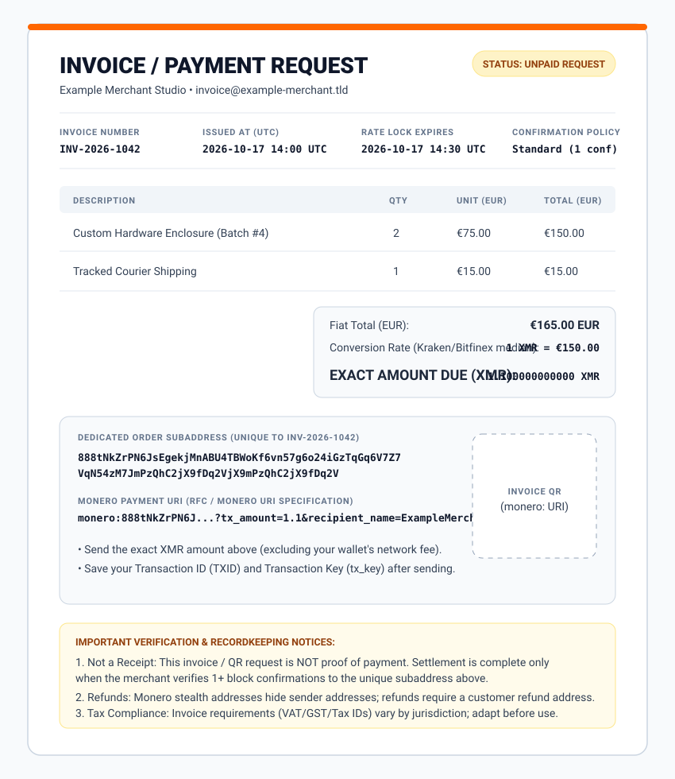

# Monero Invoice & Settlement Receipt Templates

This folder provides editable invoice and payment receipt templates for freelancers, B2B vendors, and online merchants billing in Monero (XMR).

  

---

## Important Limits & Disclaimers

1. **A Payment Request or QR Code Is Not Proof of Payment:**
   Sharing a payment link, invoice document, or QR code only communicates *where* and *how much* to pay. An invoice is settled only after the merchant's own wallet or payment server verifies the incoming transaction on the Monero network according to the stated confirmation policy.
2. **Jurisdictional Tax & Receipt Rules Vary:**
   Every country and state has specific invoicing rules (such as business registration numbers, VAT/GST breakdowns, sequential numbering, and customer billing details). Treat [`monero-invoice-template.md`](monero-invoice-template.md) as a technical Monero payment layout and add any fields required by your local tax authority.

---

## Files in This Directory

- [`monero-invoice-example.svg`](monero-invoice-example.svg): Visual vector diagram of a complete Monero invoice showing rate lock timestamps, subaddress isolation, and verification notices.
- [`monero-invoice-template.md`](monero-invoice-template.md): Copy-paste Markdown template for B2B/freelance invoices and post-payment settlement receipts.

---

## Generating Invoices in Practice

- **Zero-Server / Browser Path:** Create a shareable payment link or QR directly in [MonkStash Payment Links](https://monkstash.com/monero-payment-link) (where invoice details stay in the `#` URL fragment and your browser wallet tracks payment status automatically) or generate a standard `monero:` URI QR with the [Monero QR Code Generator](https://monkstash.com/tools/monero-qr-code-generator).
- **Automated Web Shop Path:** Run a self-hosted payment server such as [MonkStash Pay](https://monkstash.com/monero-payment-gateway) (currently in v0.1 testing) to generate time-locked subaddress invoices via `POST /api/invoices`.
