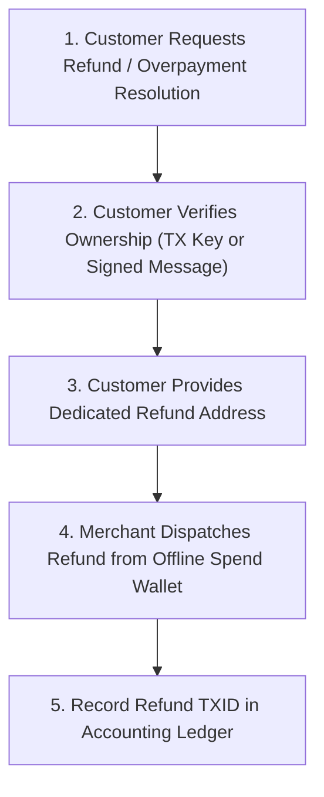

# Monero Merchant Refund & Dispute Runbook

> **Critical Notice for Merchants:** In Monero, you **cannot** automatically click "Refund to Sender Address". Due to Ring Confidential Transactions (RingCT) and one-time stealth addresses, the sender's public wallet address is never recorded on the blockchain.

This runbook defines the standard operating procedure for issuing returns, partial refunds, and handling overpayments safely.

---

## 1. Why Monero Refunds Require a Destination Address

When a customer pays with Bitcoin or Ethereum, their public wallet address is exposed on the public ledger. 

With Monero:
* The transaction uses one-time **stealth addresses** generated on the blockchain.
* The merchant's wallet sees funds arriving, but **cannot derive the customer's wallet address from the transaction data**.
* If a merchant attempts to "send funds back" to the stealth output hash, the funds will be permanently lost or burnt.

**Conclusion:** All Monero refunds require the customer to actively provide a valid refund address (primary address starting with `4` or subaddress starting with `8`).

---

## 2. Standard 4-Step Refund Workflow

### Step 1: Verification of Purchase (Proof of Payment)
Before returning funds, verify that the claimant was indeed the person who paid for the order:
* **E-Commerce Orders:** Check customer order number, email account, or signed-in customer profile.
* **Over-the-Counter / Cash Register:** Request the Transaction Hash (TXID) from the customer's wallet history matching the exact timestamp and amount.
* **Cryptographic Verification (For High Value):** Ask the customer to export their **Transaction Key (`tx_key`)** from their wallet for that specific transaction.
  - In Feather / Monero GUI / Cake: `Right Click Transaction -> Show Details -> Copy Transaction Key`.
  - Enter the Transaction Key, recipient address, and transaction hash into your wallet's `Check Payment` tool to cryptographically confirm validity.

### Step 2: Establish Refund Policy & Currency Base
Decide whether your store refunds in **Fiat Value** or **XMR Value**:
* **Option A: Fiat Base (Standard Retail):** 
  If an item cost \$50 USD and is returned, calculate the refund amount in XMR at the prevailing exchange rate at the time of refund (or issue fiat cash/store credit).
* **Option B: Crypto Base (Nominal XMR):**
  Refund the exact XMR amount received minus network mining fees.
* *Best Practice:* State your refund base clearly in your store's terms of service.

### Step 3: Collect Refund Address
* Request a fresh subaddress (starting with `8`) from the customer.
* Verify address checksum and length (95 characters).

### Step 4: Dispatch & Record
* Initiate the transfer using your primary spending wallet (e.g., cold wallet or air-gapped terminal).
* Send the Transaction ID (TXID) to the customer as proof of refund.
* Log the refund in your [Daily Sales & Refund Ledger](../accounting-templates/monero-daily-sales-ledger.csv).

---

## 3. Handling Overpayments & Underpayments

### Case 1: Overpayment
* If a customer owes 1.20 XMR but accidentally sends 2.20 XMR:
* Complete the original sale for 1.20 XMR.
* Ask the customer for their refund subaddress to return the 1.00 XMR surplus.
* Deduct the standard Monero network mining fee (typically fraction of a cent) from the excess balance before dispatching.

### Case 2: Underpayment
* If a customer owes 1.00 XMR and sends 0.85 XMR:
* Keep the invoice open in your payment software.
* Prompt the customer for the remaining delta (0.15 XMR).
* Once the delta transaction appears in the mempool, settle the order.
